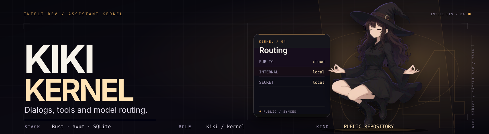

# Kiki Assistant Kernel API



[English](README.md) · [Русский](README.ru.md) · [中文](README.zh_CN.md)

One assistant core for inteli-dev.ru, the CRM and future channels.

## What it does

- `POST /v1/chat` — one message in, one answer out: model routing, tool loop and images in the current turn.
- `GET /v1/conversations` — actor sessions with title, pins, preview and search.
- `PATCH /v1/conversations/{id}` — rename, pin, archive.
- `POST /v1/conversations/{id}/regenerate` — regenerate the last answer.
- `GET /v1/conversations/{id}` — conversation history.
- `DELETE /v1/conversations/{id}` — delete a conversation.
- `POST /v1/conversations/{id}/notes` — attach a note after a confirmed CRM action.
- `GET /v1/knowledge/pricing` — shared price snapshot cached in SQLite.
- `POST /v1/studies`, `GET /v1/studies/{id}`, `POST /v1/studies/{id}/cancel` — project website research through DeepSeek Harness.
- `POST /v1/harness/runs`, `GET /v1/harness/runs/{id}`, `POST /v1/harness/runs/{id}/cancel` — free-form harness tasks; the kernel stores no runs, the channel polls.
- `/health/live`, `/health/ready`.
- `openapi.yaml` — API contract 1.3.0.

The answer budget is `KERNEL_MAX_OUTPUT_TOKENS` (8000 by default): enough for a 20–30 task plan in one tool call.

## Boundaries

The kernel never reads the site or CRM databases. It calls typed channel tools:

```text
GET  {provider}/profile?actor_id=...&actor_role=...&conversation_id=...
POST {provider}/tools/{tool}
GET  {provider}/files/{file}?conversation_id=...&actor_id=...
```

The provider returns channel rules, JSON tool schemas and hints. `conversation_id` in the profile lets a channel add project context such as `AGENTS.md`. Files are fetched by id with a service token: storage, ownership and MIME checks stay in the domain.

The kernel stores conversations, messages, image references, document manifests, step traces and usage.

## Documents

Documents work like images but without bytes: the channel sends `id`, name, MIME, character count and the first 240 characters. The full text stays in the channel and the model reads it with the `read_document` tool. A 200k-character brief never enters every request.

## Images

The CRM sends only uploaded file ids in `attachments`. The kernel:

1. checks `KERNEL_MAX_ATTACHMENTS`;
2. downloads bytes from the provider and enforces `KERNEL_MAX_ATTACHMENT_BYTES`;
3. accepts `image/jpeg`, `image/png`, `image/webp`, `image/gif`;
4. encodes them as `data:` URLs for the current message.

An image is sent only in the turn where it was uploaded. Later requests keep a text marker, not the pixels.

Vision support belongs to the endpoint, not the kernel:

```dotenv
KERNEL_CLOUD_VISION=true
KERNEL_LOCAL_VISION=false
```

If an image arrives on a text-only route, the kernel returns `422` instead of silently dropping it.

## Pricing

The price list belongs to the site. The kernel fetches a snapshot from the `site` provider (`GET {provider}/prices`), caches it in SQLite and shares it with every channel:

```http
GET /v1/knowledge/pricing
Authorization: Bearer $KERNEL_CRM_TOKEN
X-Kernel-Channel: crm
```

`get_price_list` is added to the tools of every channel. If the site is unavailable, the last snapshot is returned with `stale: true`; TTL is `KERNEL_PRICING_TTL_SECONDS` (15 minutes by default).

## Studies and harness

Research runs in a separate `harness` service. The kernel only creates a job and polls the result:

```dotenv
KERNEL_HARNESS_URL=http://harness:8090
KERNEL_HARNESS_TOKEN=change-me-harness
KERNEL_HARNESS_TIMEOUT_SECONDS=300
```

The agent works in `/data/workspaces/<run_id>`, sees `BRIEF.md` and the existing `AGENTS.md`, reads up to six pages and writes `AGENTS.md` (≤120 lines) plus `PRICE-NOTES.md`. `lean.yml` disables subagents, workflows, MCP, plan mode and web search to keep the prompt cheap.

The runner also connects the CRM MCP as `dsh-mcp-client`: it builds `/data/mcp.yml` from `CRM_MCP_URL` and `CRM_MCP_TOKEN`. The agent sees `mcp__crm__*` tools, including `create_task_report`.

## Tracing and sessions

`ChatOutput.trace` lists model notes, tool calls, status, duration and a short result. The kernel stores the trace on the message; the channel mirrors it for the UI.

Titles, pins and archives belong to the kernel. The channel keeps a UI mirror for short outages but never overrides them. The title comes from the first message and is not rewritten later. `regenerate` removes the answer tail and runs the turn again without duplicating the question.

## Run

```bash
cp .env.example .env
# fill tokens and the local model endpoint
docker compose up -d --build
curl http://127.0.0.1:8090/health/ready
```

The compose file creates the external network `inteli-dev-assistant`. The site and CRM join it.

## Data routing

- `public` — cloud model if configured, otherwise local.
- `internal` and `secret` — local model only. Without one the request returns `503`; it never goes to the cloud.
- `KERNEL_ALLOW_CLOUD_FOR_INTERNAL=true` is for local development only. Keep it `false` in production.

## Provider networking

`KERNEL_SITE_PROVIDER_URL` and `KERNEL_CRM_PROVIDER_URL` must use unique host names. Several stacks on `inteli-dev-assistant` can declare the same alias (`web`, `nginx`, `app`), and Docker DNS may answer from the wrong container.

The CRM publishes `crm-app` and `crm-nginx`; the kernel calls `http://crm-nginx/...`. The local site is addressed by its container name. Use your own service names in production.

## Tokens

Each channel has its own inbound token (`KERNEL_SITE_TOKEN`, `KERNEL_CRM_TOKEN`) and provider token (`KERNEL_SITE_PROVIDER_TOKEN`, `KERNEL_CRM_PROVIDER_TOKEN`). Tokens never reach the browser.

## ADRs

- [ADR-001: kernel and domain providers](docs/ADR-001-assistant-kernel.md)
- [ADR-002: sessions, images and regenerate](docs/ADR-002-sessions-and-images.md)
- [ADR-003: documents, prices and site studies](docs/ADR-003-documents-prices-and-study.md)
