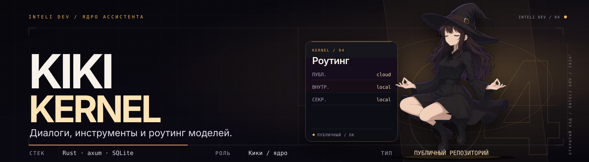

# Kiki Assistant Kernel API



[English](README.md) · [Русский](README.ru.md) · [中文](README.zh_CN.md)

Одно ядро ассистента для сайта inteli-dev.ru, CRM и будущих каналов.

## Что здесь есть

- `POST /v1/chat` — одно сообщение на входе, один ответ: маршрутизация модели, tool loop и изображения в текущем ходе.
- `GET /v1/conversations` — сессии актора: заголовок, пины, превью и поиск.
- `PATCH /v1/conversations/{id}` — переименование, пин, архив.
- `POST /v1/conversations/{id}/regenerate` — переответ на последний вопрос.
- `GET /v1/conversations/{id}` — история диалога.
- `DELETE /v1/conversations/{id}` — удаление диалога.
- `POST /v1/conversations/{id}/notes` — заметка после подтверждённого действия CRM.
- `GET /v1/knowledge/pricing` — общий снимок прайса, кэш в SQLite.
- `POST /v1/studies`, `GET /v1/studies/{id}`, `POST /v1/studies/{id}/cancel` — изучение сайта проекта через DeepSeek Harness.
- `POST /v1/harness/runs`, `GET /v1/harness/runs/{id}`, `POST /v1/harness/runs/{id}/cancel` — свободные задачи harness; ядро не хранит прогоны, канал сам опрашивает статус.
- `/health/live`, `/health/ready`.
- `openapi.yaml` — контракт API 1.3.0.

Бюджет ответа — `KERNEL_MAX_OUTPUT_TOKENS` (по умолчанию 8000): хватает на план из 20–30 задач одним tool call.

## Границы

Ядро не читает базы сайта и CRM. Оно вызывает типизированные инструменты каналов:

```text
GET  {provider}/profile?actor_id=...&actor_role=...&conversation_id=...
POST {provider}/tools/{tool}
GET  {provider}/files/{file}?conversation_id=...&actor_id=...
```

Провайдер возвращает правила канала, JSON-схемы инструментов и подсказки. `conversation_id` в профиле позволяет каналу подмешать контекст проекта, например `AGENTS.md`. Файл забирается по id с сервисным токеном: хранилище, проверка владельца и MIME остаются в домене.

Ядро хранит диалоги, сообщения, ссылки на изображения, манифесты документов, tracer шагов и usage.

## Документы

Документы устроены как изображения, но без байтов: канал присылает `id`, имя, MIME, число символов и первые 240 символов. Полный текст остаётся в канале, а модель читает его инструментом `read_document`. Бриф на 200 тыс. символов не попадает в каждый запрос.

## Изображения

CRM присылает в `attachments` только идентификаторы загруженных файлов. Ядро:

1. проверяет число вложений (`KERNEL_MAX_ATTACHMENTS`);
2. забирает байты у провайдера и ограничивает размер (`KERNEL_MAX_ATTACHMENT_BYTES`);
3. пропускает только `image/jpeg`, `image/png`, `image/webp`, `image/gif`;
4. кодирует в `data:` URL и отправляет в текущем сообщении.

Изображение уходит в модель только в том ходе, где его отправили. В следующих запросах остаётся текстовая пометка, а не повторная картинка.

Поддержка зрения — свойство endpoint, а не ядра:

```dotenv
KERNEL_CLOUD_VISION=true
KERNEL_LOCAL_VISION=false
```

Если изображение пришло на текстовый маршрут, ядро отвечает `422`, а не теряет картинку молча.

## Прайс-лист

Прайс принадлежит сайту. Ядро забирает снимок у `site`-провайдера (`GET {provider}/prices`), кэширует в SQLite и отдаёт всем каналам:

```http
GET /v1/knowledge/pricing
Authorization: Bearer $KERNEL_CRM_TOKEN
X-Kernel-Channel: crm
```

Инструмент `get_price_list` добавляется в tools любого канала. Если сайт недоступен, отдаётся последний снимок с `stale: true`; TTL — `KERNEL_PRICING_TTL_SECONDS` (15 минут по умолчанию).

## Изучение сайта и harness

Изучение выполняет отдельный сервис `harness`. Ядро создаёт задание и опрашивает результат, поэтому чат не блокируется на минуты:

```dotenv
KERNEL_HARNESS_URL=http://harness:8090
KERNEL_HARNESS_TOKEN=change-me-harness
KERNEL_HARNESS_TIMEOUT_SECONDS=300
```

Агент работает в `/data/workspaces/<run_id>`, видит `BRIEF.md` и существующий `AGENTS.md`, читает до шести страниц и пишет `AGENTS.md` (≤120 строк) и `PRICE-NOTES.md`. `lean.yml` отключает subagent, workflow, MCP, plan и web-search, чтобы промпт был дешевле.

Раннер подключает CRM MCP как `dsh-mcp-client`: собирает `/data/mcp.yml` из `CRM_MCP_URL` и `CRM_MCP_TOKEN`. Агент видит инструменты `mcp__crm__*`, включая `create_task_report`.

## Трассировка и сессии

`ChatOutput.trace` — список шагов: заметка модели, вызов инструмента, статус, длительность и краткий результат. Ядро пишет trace в сообщение, канал зеркалит его для UI.

Заголовок, пин и архив принадлежат ядру. Канал держит зеркало для UI и краткой недоступности, но не переопределяет эти поля. Заголовок ставится из первого сообщения и не перезаписывается. `regenerate` удаляет хвост ответа и прогоняет ход заново без дубликата вопроса.

## Запуск

```bash
cp .env.example .env
# заполнить токены и адрес локальной модели
docker compose up -d --build
curl http://127.0.0.1:8090/health/ready
```

Compose создаёт внешнюю сеть `inteli-dev-assistant`. Сайт и CRM подключаются к ней.

## Маршрутизация данных

- `public` — облачная модель, если настроена; иначе локальная.
- `internal` и `secret` — только локальная модель. Если её нет, запрос завершается `503`, а не уходит в облако.
- `KERNEL_ALLOW_CLOUD_FOR_INTERNAL=true` — только для локальной разработки. В продакшене держите `false`.

## Сеть провайдеров

`KERNEL_SITE_PROVIDER_URL` и `KERNEL_CRM_PROVIDER_URL` должны указывать на уникальный хост. На общей сети `inteli-dev-assistant` несколько стеков могут объявить один алиас (`web`, `nginx`, `app`), и Docker DNS начнёт отвечать не тому контейнеру.

CRM объявляет алиасы `crm-app` и `crm-nginx`; ядро обращается к `http://crm-nginx/...`. Локальный сайт адресуется по имени контейнера. В продакшене подставьте свои имена сервисов.

## Токены

У каждого канала свой входящий токен (`KERNEL_SITE_TOKEN`, `KERNEL_CRM_TOKEN`) и токен провайдера (`KERNEL_SITE_PROVIDER_TOKEN`, `KERNEL_CRM_PROVIDER_TOKEN`). Токены не передаются в браузер.

## Решения

- [ADR-001: ядро и доменные провайдеры](docs/ADR-001-assistant-kernel.md)
- [ADR-002: сессии, изображения и regenerate](docs/ADR-002-sessions-and-images.md)
- [ADR-003: документы, прайс и изучение сайта](docs/ADR-003-documents-prices-and-study.md)
