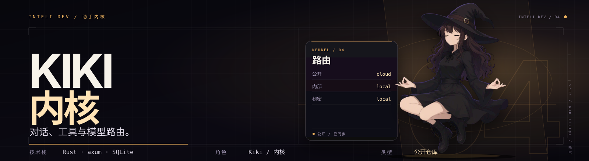

# Kiki Assistant Kernel API



[English](README.md) · [Русский](README.ru.md) · [中文](README.zh_CN.md)

inteli-dev.ru、CRM 和未来渠道共用的一个助手内核。

## 能力

- `POST /v1/chat` — 一问一答：模型路由、工具循环，以及当前消息中的图片。
- `GET /v1/conversations` — 会话列表：标题、置顶、预览和搜索。
- `PATCH /v1/conversations/{id}` — 重命名、置顶、归档。
- `POST /v1/conversations/{id}/regenerate` — 重新生成上一条回答。
- `GET /v1/conversations/{id}` — 会话历史。
- `DELETE /v1/conversations/{id}` — 删除会话。
- `POST /v1/conversations/{id}/notes` — CRM 操作确认后写入备注。
- `GET /v1/knowledge/pricing` — 价格快照，缓存在 SQLite。
- `POST /v1/studies`、`GET /v1/studies/{id}`、`POST /v1/studies/{id}/cancel` — 通过 DeepSeek Harness 研究项目网站。
- `POST /v1/harness/runs`、`GET /v1/harness/runs/{id}`、`POST /v1/harness/runs/{id}/cancel` — 自由 harness 任务；内核不保存运行记录，由渠道轮询。
- `/health/live`、`/health/ready`。
- `openapi.yaml` — API 1.3.0 契约。

回答预算由 `KERNEL_MAX_OUTPUT_TOKENS` 控制，默认 8000：足够一次工具调用生成 20–30 个任务的计划。

## 边界

内核不读取网站或 CRM 数据库，而是调用渠道的类型化工具：

```text
GET  {provider}/profile?actor_id=...&actor_role=...&conversation_id=...
POST {provider}/tools/{tool}
GET  {provider}/files/{file}?conversation_id=...&actor_id=...
```

提供方返回渠道规则、JSON 工具定义和提示。profile 中的 `conversation_id` 让渠道附加项目上下文，例如 `AGENTS.md`。文件按 id 用服务令牌读取：存储、归属和 MIME 检查留在业务域。

内核保存会话、消息、图片引用、文档清单、步骤 trace 和 usage。

## 文档

文档和图片类似，但不传字节：渠道发送 `id`、名称、MIME、字符数和前 240 个字符。完整文本留在渠道，模型用 `read_document` 工具读取。20 万字符的简报不会进入每次请求。

## 图片

CRM 在 `attachments` 中只发送已上传文件的 id。内核：

1. 检查 `KERNEL_MAX_ATTACHMENTS`；
2. 从提供方下载字节并限制 `KERNEL_MAX_ATTACHMENT_BYTES`；
3. 只接受 `image/jpeg`、`image/png`、`image/webp`、`image/gif`；
4. 编码为 `data:` URL，只在当前消息中发送。

图片只在发送它的那一轮进入模型。后续请求保留文本标记，而不是重复像素。

视觉能力属于 endpoint，而不是内核：

```dotenv
KERNEL_CLOUD_VISION=true
KERNEL_LOCAL_VISION=false
```

图片走到纯文本路由时，内核返回 `422`，不会静默丢弃。

## 价格

价格属于网站。内核从 `site` 提供方获取快照（`GET {provider}/prices`），缓存在 SQLite，并共享给所有渠道：

```http
GET /v1/knowledge/pricing
Authorization: Bearer $KERNEL_CRM_TOKEN
X-Kernel-Channel: crm
```

`get_price_list` 会加入每个渠道的工具集。网站不可用时返回最后一次快照并带 `stale: true`；TTL 为 `KERNEL_PRICING_TTL_SECONDS`，默认 15 分钟。

## 网站研究与 harness

研究在独立的 `harness` 服务中运行。内核只创建任务并轮询结果：

```dotenv
KERNEL_HARNESS_URL=http://harness:8090
KERNEL_HARNESS_TOKEN=change-me-harness
KERNEL_HARNESS_TIMEOUT_SECONDS=300
```

Agent 在 `/data/workspaces/<run_id>` 工作，读取 `BRIEF.md` 和现有 `AGENTS.md`，最多读取六个页面，写入 `AGENTS.md`（≤120 行）和 `PRICE-NOTES.md`。`lean.yml` 关闭 subagent、workflow、MCP、plan 和 web-search，以降低提示成本。

Runner 还会把 CRM MCP 接入为 `dsh-mcp-client`：根据 `CRM_MCP_URL` 和 `CRM_MCP_TOKEN` 生成 `/data/mcp.yml`。Agent 可以看到 `mcp__crm__*` 工具，包括 `create_task_report`。

## 追踪与会话

`ChatOutput.trace` 列出模型备注、工具调用、状态、耗时和简短结果。内核把 trace 写入消息，渠道为 UI 保留镜像。

标题、置顶和归档归内核所有。渠道为 UI 和短暂故障保留镜像，但不覆盖这些字段。标题来自第一条消息，后续不会重写。`regenerate` 删除回答尾部并重新执行该轮，不会重复问题。

## 启动

```bash
cp .env.example .env
# 填写令牌和本地模型地址
docker compose up -d --build
curl http://127.0.0.1:8090/health/ready
```

Compose 会创建外部网络 `inteli-dev-assistant`，网站和 CRM 加入该网络。

## 数据路由

- `public` — 已配置时走云模型，否则走本地。
- `internal` 和 `secret` — 只走本地模型。没有本地模型时返回 `503`，不会发往云端。
- `KERNEL_ALLOW_CLOUD_FOR_INTERNAL=true` 只用于本地开发。生产环境保持 `false`。

## 提供方网络

`KERNEL_SITE_PROVIDER_URL` 和 `KERNEL_CRM_PROVIDER_URL` 必须使用唯一主机名。`inteli-dev-assistant` 上的多个栈可能声明同一个别名（`web`、`nginx`、`app`），Docker DNS 可能返回错误的容器。

CRM 声明 `crm-app` 和 `crm-nginx`，内核访问 `http://crm-nginx/...`。本地网站使用容器名。生产环境请替换为实际服务名。

## 令牌

每个渠道有独立的入站令牌（`KERNEL_SITE_TOKEN`、`KERNEL_CRM_TOKEN`）和提供方令牌（`KERNEL_SITE_PROVIDER_TOKEN`、`KERNEL_CRM_PROVIDER_TOKEN`）。令牌不会进入浏览器。

## 决策

- [ADR-001：内核与领域提供方](docs/ADR-001-assistant-kernel.md)
- [ADR-002：会话、图片与 regenerate](docs/ADR-002-sessions-and-images.md)
- [ADR-003：文档、价格与网站研究](docs/ADR-003-documents-prices-and-study.md)
