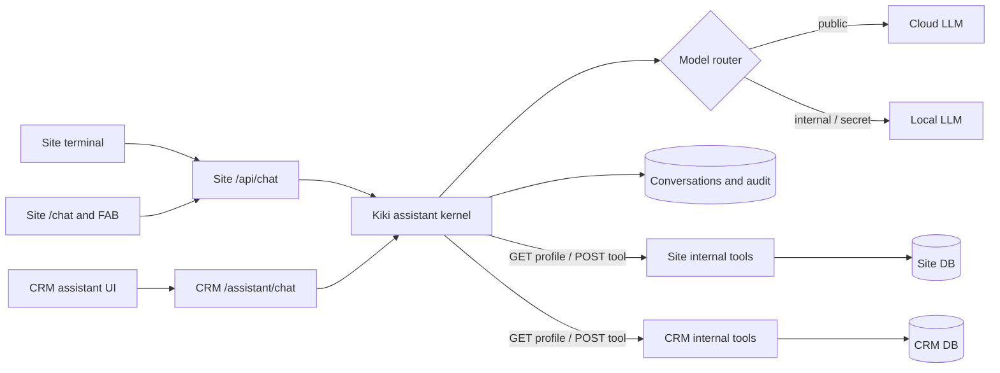

# ADR-001: Central Kiki assistant kernel with domain tool providers

## Status

Accepted for the current single-operator inteli-dev deployment.

## Context

Kiki exists in three surfaces: the site terminal, `/chat`, the floating site
panel and the CRM assistant. Before this change the site owned a `ChatService`
with its own LLM and OpenViking calls, while CRM owned an `AgentService` with a
separate OpenAI-compatible client and tool loop. The two assistants had
different prompts, memory, model settings, tool execution and audit.

The product needs one Kiki character and one evaluation target, while the site
and CRM must keep exclusive ownership of their data. A separate per-service
assistant would duplicate the core and make behaviour drift. A central service
with a generic database API would create a god service and a large blast radius.

## Decision

Use one assistant kernel with two contracts:

1. **Northbound channel API** (`/v1/chat`, conversations, notes) for site and
   CRM BFFs. Each channel has its own bearer token.
2. **Southbound domain tool contract** (`GET /profile`, `POST /tools/{tool}`)
   exposed by each domain service. The kernel calls providers with a separate
   service token.

The kernel owns:

- the Kiki base identity and safety rules;
- model routing (cloud for public, local for internal and secret);
- conversation state, tool-call traces, usage and audit;
- the tool loop, timeouts, retries, circuit breaker and correlation IDs.

The domains own:

- content, prices, status and leads (site);
- clients, tasks, invoices, permissions and confirmation actions (CRM);
- the exact JSON schemas of their tools and their authorization rules.

The kernel never receives a database credential and never generates SQL.

## Architecture

## Why not per-service assistants

- Prompt, safety and evaluation drift across surfaces.
- N copies of rate limits, cost controls and model routing.
- N data-access paths and credentials.
- Users compare answers and lose trust when prices or status differ.

## Why not one service with a shared database API

- A generic query API turns the kernel into a god service.
- One prompt injection can reach every domain.
- Shared schema couples releases and violates domain ownership.

## Consequences

Positive:

- one persona, one prompt baseline, one evaluation target;
- public data can use cloud, private data stays local;
- domain services keep their permissions and confirmations;
- the kernel is independently deployable and has its own database;
- tool calls and conversations are auditable in one place.

Negative:

- one more deployable, network hop and failure mode;
- CRM keeps a user-facing audit mirror while the kernel is authoritative for
  the model conversation; this should become a read-through later;
- provider contracts must be versioned;
- local model capacity becomes a shared dependency for CRM.

## Migration

1. Kernel and its database are deployed first.
2. Site points free-form questions at the kernel; deterministic presets remain
   local.
3. CRM points its assistant at the kernel and exposes its toolbox as tools.
4. Old direct LLM paths remain behind an empty `KERNEL_URL` for local tests and
   can be removed after evaluation.
5. If a second team or a separate data boundary appears, the kernel already has
   a network contract and can be scaled independently.

## Operational rules

- `KERNEL_ALLOW_CLOUD_FOR_INTERNAL=false` in production.
- Separate inbound and provider tokens; rotate them independently.
- Provider token endpoints are internal-only and must not be exposed by the
  public reverse proxy.
- Health: `/health/live` for process, `/health/ready` for database.
- Correlation ID: `X-Correlation-Id` through the channel, kernel and provider.
- Tool writes that need confirmation create a domain action and stop the loop.
